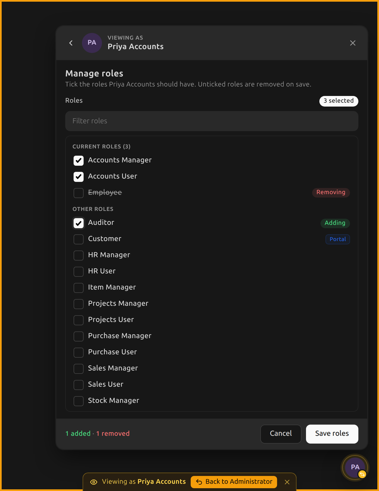
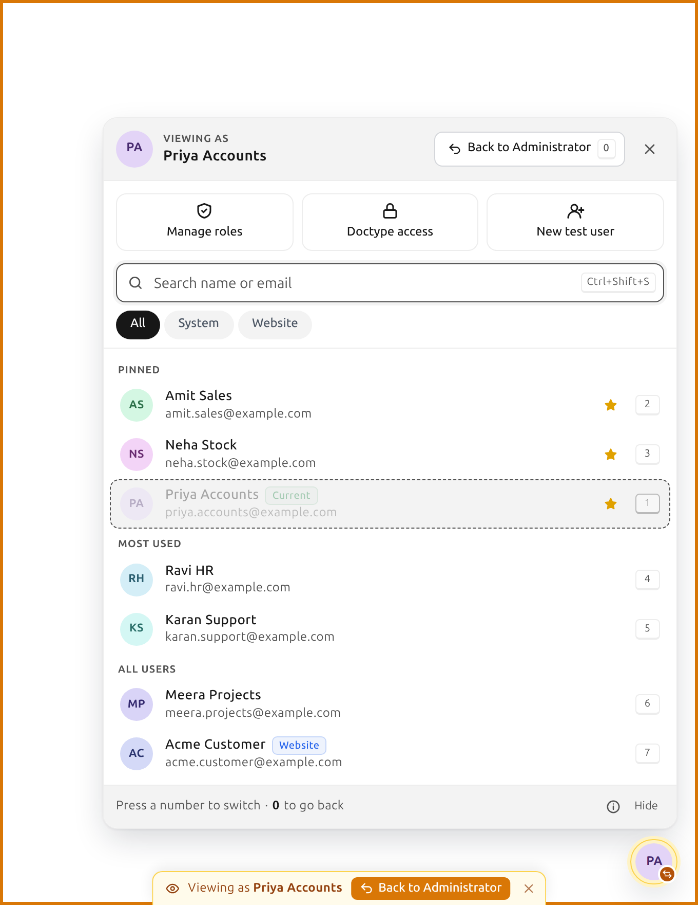
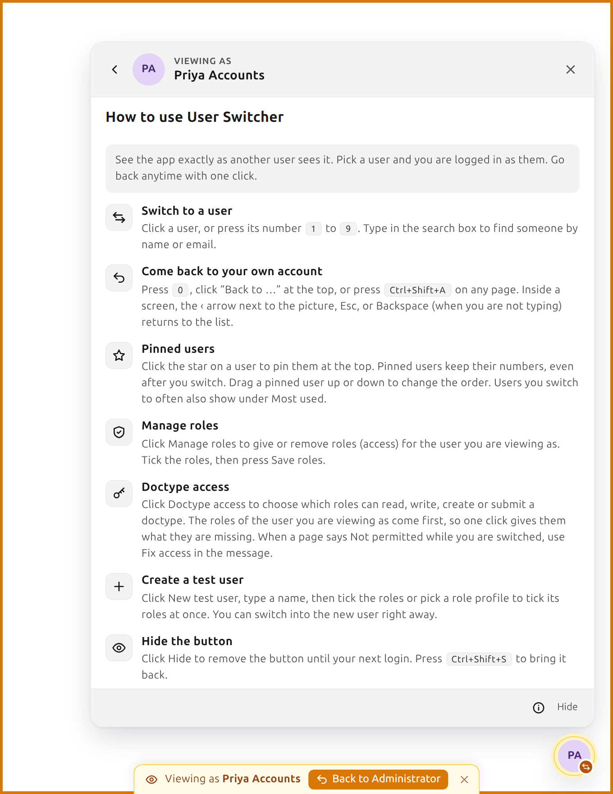
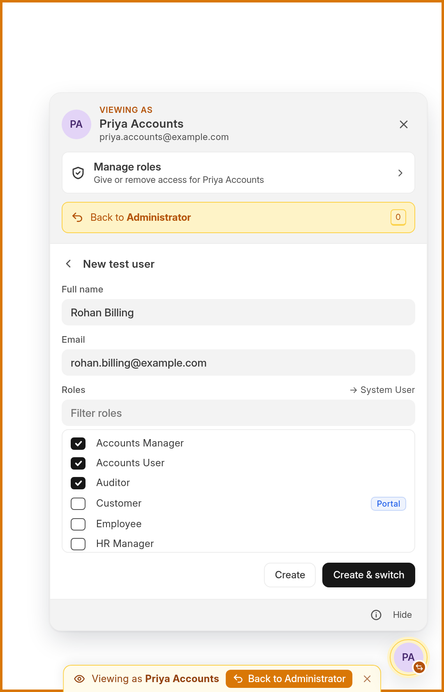

# User Switcher

**Switch between user accounts with one key. See exactly what each user sees.**

User Switcher is a Frappe and ERPNext app for developers, implementers, and QA teams. It adds a floating switcher to every Desk page and website page. Use it to check permissions, workflows, dashboards, and portal pages as any user. Return to your own account with one key.


[](https://github.com/renish-1111/user_switcher)

<p align="center">
  
  &nbsp;
  
</p>

<p align="center">
  
  &nbsp;
  
</p>

> [!WARNING]
> This is a development and testing tool. It is off by default. It works only when **both** `developer_mode` and `user_switcher_enabled` are on (see [Configuration](#configuration)). Every switch is logged. Do not turn it on for a live site unless you accept the risk.

---

## Contents

- [Features](#features)
- [Installation](#installation)
- [Usage](#usage)
- [Keyboard shortcuts](#keyboard-shortcuts)
- [Configuration](#configuration)
- [Security model](#security-model)
- [How it works](#how-it-works)
- [API reference](#api-reference)
- [Troubleshooting](#troubleshooting)
- [Development](#development)
- [License](#license)

---

## Features

| | |
|---|---|
| **Floating switcher on every page** | Works in Desk (`/app`) and on website and portal pages. It shows the user you are viewing as. It gets an amber ring while you are switched. |
| **Pinned users** | Click the star on a user to pin that user at the top. Each pinned user keeps a fixed number (1, 2, 3, and so on), even after you switch. |
| **Drag to reorder** | Drag a pinned user up or down. The other rows slide out of the way, and the new order is saved when you drop. |
| **Most used** | Users you switch to often come next. They are ranked by how often and how recently you pick them. |
| **Keyboard first** | Press `Ctrl+Shift+S` to open the switcher. Press `1` to `9` to switch. Press `Ctrl+Shift+A` to go back from any page. |
| **"Viewing as" banner** | While you are switched, a thin amber frame and a "Viewing as … · Back" pill show on every page. They never block clicks. |
| **Manage roles** | Give or remove roles for the user you are viewing as. The roles that user already has show first, ticked. |
| **Doctype access** | Choose which roles can select, read, write, create, delete, submit, cancel, or amend a doctype. The roles of the user you are viewing as show first. |
| **Fix access** | While you are switched, a "Not permitted" error shows a **Fix access** link. It opens Doctype access for that doctype. |
| **Create test users** | Make a user with the roles you choose. Switch into that user right away. The app sends no welcome email. |
| **Search and filters** | Search by name or email. Filter by System users or Website users. |
| **How-to guide** | Click the **ⓘ** button next to **Hide**. A short guide in plain language explains every feature. |
| **Audit trail** | Every switch is saved in the read-only **User Switch Log**. A report lists the log with filters. |
| **Safe by default** | It needs two settings. It ends a switched session when the real user loses the right to switch. It logs refused requests. |
| **Looks native** | It uses the Frappe theme colors, so it follows light mode and dark mode. It works on small screens and respects the reduced-motion setting. |

---

## Installation

```bash
cd ~/frappe-bench                  # your bench folder
SITE=mysite.localhost              # your site name (see: ls sites/)

bench get-app https://github.com/renish-1111/user_switcher --branch develop
bench --site $SITE install-app user_switcher
bench --site $SITE migrate
bench build --app user_switcher
bench --site $SITE clear-cache
```

Then turn the app on for the site. Set `developer_mode` and `user_switcher_enabled` (see [Configuration](#configuration)). Hard-refresh the browser with `Ctrl+Shift+R`. The switcher button shows at the bottom-right of every page.

**Requirements:** Frappe v16 and Python 3.14 or newer. ERPNext is optional. The app works on plain Frappe.

---

## Usage

### Switching users

1. Click the round avatar button at the bottom-right, or press **`Ctrl+Shift+S`**.
2. Type in the search box, use the arrow keys, or press the number of a user (**`1`** to **`9`**).
3. The page reloads as that user.

Desk opens at `/app` after a switch. The page you were on may not be allowed for the new user.

### Going back

Use any of these to return to the account you logged in with:

- Press **`Ctrl+Shift+A`** on any page.
- Press **`0`** while the switcher is open.
- Click the **Back to …** button in the switcher or in the amber banner.

### Pinned users

1. Hover over a user and click the star **☆**. The user moves to the **Pinned** group at the top.
2. Click the star again to unpin.

Pinned users keep their numbers. The numbers do not change after you switch.

If you are viewing as a pinned user, that user stays in its numbered place with a green **Current** tag. A click or a number key on that row does nothing, because you are already that user.

To change the order, drag a pinned user up or down. The other pinned users slide out of the way as you drag. Release the mouse to save the order. Release the mouse outside the switcher to cancel.

> [!NOTE]
> Drag and drop needs a mouse. It does not work on touch screens. The order is saved in your browser, not on the server.

### Creating a test user

1. Open the switcher and click **+ Test user**.
2. Enter a full name. The email fills in as `<name>@example.com`. You can change it.
3. Tick the roles. The form shows if the result is a **System User** or a **Website User**. Frappe decides this from the roles.
4. Click **Create & switch**, or click **Create**.

<p align="center"></p>

The app sends no welcome email to a test user. The bio of the user says "Test user created with User Switcher by …". Use the bio to find and delete test users later.

### Managing roles

1. Open the switcher.
2. Click **Manage roles** under the name at the top. This changes the roles of the user you are viewing as, or your own roles if you are not switched.
3. Read the list. The roles the user already has show first, under **Current roles**, and they are ticked.
4. Tick the roles to add. Untick the roles to remove.
5. Click **Save roles**. The button stays off until you change something.
6. The page reloads so the new roles apply.

These rules apply:

- The **Manage roles** button does not show when you are viewing as Administrator.
- You cannot edit Guest or other System Managers.
- You cannot remove System Manager from your own account.
- The roles All, Guest, Administrator, and Desk User are never offered.

Roles are saved on the User. The change shows in the Version history of that user.

### Giving a role access to a doctype

1. Open the switcher on the page of a doctype, for example a Sales Invoice.
2. Click **Doctype access** at the top. The doctype of the page fills in. Type another name to change it.
3. Read the box at the top. It shows what the user you are viewing as can do (**Allowed**) and what is **Missing**.
4. Click a right, for example **Create**, on one of that user's roles. The roles of that user show first, even roles with no access yet.
5. To give access to another role, type its name in **Search roles or add one** and click it under **Add a role**.
6. Click **Save & reload**. A blue ring marks each change that is not saved yet.

Some rights need others. The screen turns them on for you. For example, **Submit** also turns on **Write** and **Read**, and **Cancel** also turns on **Submit**. Turning a right off also turns off the rights that need it. Tick **All rights** to see Print, Email, Report, Import, Export, and Share.

If a page says **Not permitted** while you are switched, click **Fix access** in the message. It opens the same screen for that doctype.

These rules apply:

- A change applies to **every** user with that role, not only the user you are viewing as.
- The app saves the rules in **Custom DocPerm**, the same place as Role Permission Manager. After the first change to a doctype, app updates no longer change its standard rules. Reset the doctype in Role Permission Manager to get them back.
- The rules for All, Guest, and Desk User show under **Everyone**, but you cannot change them here, because they apply to every user.
- Field-level rules and "only if creator" rules are not on this screen. Use the link at the bottom to open Role Permission Manager.
- The doctypes DocType, Patch Log, Module Def, and child tables are not offered.

### How-to guide

Click the **ⓘ** button next to **Hide** at the bottom of the switcher. The guide opens inside the switcher. Click the back arrow, click **ⓘ** again, or press `Esc` to return to the list.

### Hiding the switcher

Click **Hide** at the bottom of the switcher. The button stays hidden until your next browser session. Press `Ctrl+Shift+S` to bring it back.

### Audit log

Every switch creates a record in the **User Switch Log**. A System Manager can open the **User Switch Log** list from the Desk search bar. Administrator can also open the **User Switch Log Report**. It filters by date, real user, target user, action, and IP address. The log is read-only. Nobody can edit or delete a record in the app.

---

## Keyboard shortcuts

| Shortcut | Where | Action |
|---|---|---|
| `Ctrl+Shift+S` / `⌘+Shift+S` | Any page | Open or close the switcher |
| `1` – `9` | Switcher open, search box empty | Switch to the user with that number |
| `0` | Switcher open, while switched | Switch back |
| `↑` `↓` `Enter` | Switcher open | Move through the list and switch |
| `Esc` | Switcher open | Close the guide, leave a form, or close the switcher |
| `Ctrl+Shift+A` / `⌘+Shift+A` | Any page | Switch back to the account you logged in with (usually Administrator) |

The number keys do nothing while the how-to guide or a form is open.

> [!NOTE]
> The app does not use `Ctrl+S`, because Frappe uses it for **Save**. `Ctrl+Shift+A` replaces the "Search tabs" shortcut of Chrome, but only on the pages of your Frappe site.

---

## Configuration

The switcher works only when **both** settings are on in the site config. `developer_mode` alone is not enough, because people often leave it on by habit or by mistake on a live site.

```bash
bench --site $SITE set-config developer_mode 1
bench --site $SITE set-config user_switcher_enabled 1
bench restart
```

To turn the app off, remove either setting. The button disappears and the API refuses all requests. A session that someone switched into ends on its next request.

**Who can switch:** Administrator, and any enabled user with the **System Manager** role. A System Manager cannot switch into Administrator. A System Manager also cannot switch into another System Manager, unless the first user created the second user and the second user has no password. To change the allowed roles, edit `ALLOWED_ROLES` in `user_switcher/api.py`.

**Logs:** the app writes refused requests, ended sessions, and doctype access changes to `logs/user_switcher.log` in the bench folder. It writes the same lines to `sites/$SITE/logs/user_switcher.log`.

---

## Security model

User Switcher lets a System Manager act as other users. The app limits this power with the rules below.

| Rule | How the app enforces it |
|---|---|
| Only allowed users can switch | The server checks every API call. Hiding the button in the browser is only a convenience. |
| Two settings, not one | The app needs `developer_mode` **and** `user_switcher_enabled`. Only an enabled user can switch. |
| Permission follows the **real** user | The check uses the account that logged in. Switching into a user with fewer rights does not stop you from switching back. |
| No escalation to Administrator | Only the real Administrator can switch into `Administrator`. A System Manager cannot. |
| No cross-site request forgery | Switching, creating users, and changing roles accept only POST requests, protected by the Frappe CSRF token. |
| Links cannot switch you | The app has no page or link that starts a switch. A switch starts only from a button in the switcher, and it sends a POST request with the CSRF token. |
| Real sessions | The app creates a new session, with the same method as the Frappe Impersonate feature. It then deletes the old session. |
| No orphaned sessions | A switched session ends on its next request if the real user is disabled, loses System Manager, or the app is turned off. |
| Auditable | Every switch is saved in the read-only **User Switch Log** (who, into whom, when, IP address). The app writes the log first. If the write fails, the switch does not happen. |
| Role changes are traceable | The app saves role changes on the User. They show in the Version history, tagged as impersonated when someone makes them while switched. |
| Refusals are logged | The app writes refused switch, role, and test-user requests to `logs/user_switcher.log`, with the user, the target, and the IP address. |
| Safe output | The app escapes names, emails, and image URLs as HTML wherever it shows them. |
| Test-user safety | The app checks role names against the Role list. It never assigns `Administrator`, `All`, `Guest`, or `Desk User`. |
| Doctype access limits | Only a user who can switch can change doctype rules. The rules for `All`, `Guest`, `Administrator`, and `Desk User` cannot be changed. The app writes each change to `logs/user_switcher.log`. |
| Role management limits | Only a user who can switch can change roles. Administrator and Guest cannot be edited. Other System Managers are off limits, as they are for switching. A user cannot remove System Manager from their own account. |

---

## How it works

```
┌───────────────── browser ─────────────────┐        ┌──────────── server ─────────────┐
│ user_switcher.bundle.js                   │        │ user_switcher/api.py            │
│   floating widget  ── get_context ────────┼──GET──►│   _can_switch(real user)        │
│   Ctrl+Shift+S/A   ── switch_to_user ─────┼─POST──►│   write User Switch Log         │
│   Back buttons     ── switch_back ────────┼─POST──►│   login_manager.login_as()      │
│   Manage roles     ── set_user_roles ─────┼─POST──►│   session.set_impersonated()    │
│   banner           ── create_test_user ───┼─POST──►│   delete the old session        │
│                                           │        │                                 │
│ localStorage: pins + usage, per real user │        │ hooks: extend_bootinfo,         │
│                                           │        │        before_request           │
└───────────────────────────────────────────┘        └─────────────────────────────────┘
```

- **Switching:** the app writes the User Switch Log. It then creates a new session with `LoginManager.login_as()` and marks the session with `impersonated_by = <real user>`. This is the same flag the Frappe **Impersonate** feature uses. The "Impersonating" pill in Desk and the tags in the Version history work as usual.
- **Assets:** Frappe loads the app files with `app_include_*` (Desk) and `web_include_*` (website). Every build has a new file name, so a browser never runs an old copy.
- **Boot:** the `extend_bootinfo` hook sets `frappe.boot.user_switcher_allowed`. Desk makes no extra request when a page loads. Website pages ask once for each browser session and remember the answer.
- **Orphaned sessions:** the `before_request` hook checks every switched session. It ends the session if the real user may no longer switch.
- **Pins and usage:** the browser keeps them in `localStorage`, separately for each real user. They stay in that browser. The app never sends them to the server.
- **Drag and drop:** the browser swaps the pinned rows in the page while you drag and animates the move. It saves the new order only when you drop.

### Project layout

```
user_switcher/
├── user_switcher/
│   ├── api.py                          # access checks, switching, roles, test users
│   ├── boot.py                         # frappe.boot.user_switcher_allowed
│   ├── hooks.py                        # asset includes, boot, before_request
│   ├── patches/                        # one-time clean-up patches
│   ├── public/
│   │   ├── js/user_switcher.bundle.js  # widget, shortcuts, banner, guide, drag and drop
│   │   └── css/user_switcher.bundle.css
│   ├── tests/test_api.py               # server tests
│   └── user_switcher/
│       ├── doctype/user_switch_log/    # read-only audit log
│       └── report/user_switch_log_report/
└── docs/screenshots/
```

---

## API reference

All methods are in `user_switcher.api`. The **real** user of the caller must be allowed to switch.

| Method | HTTP | Arguments | Returns |
|---|---|---|---|
| `get_context` | GET | `txt?`, `user_type?` (`System User` or `Website User`), `limit=30` (maximum 100, `0` only checks permission) | `{allowed, real_user, current_user, is_switched, users[]}`. Each user includes `roles`. |
| `switch_to_user` | POST | `target_user` | `{current_user}`. Sets the new session cookie. |
| `switch_back` | POST | none | The same as `switch_to_user(<real user>)` |
| `get_assignable_roles` | GET | none | `[{name, desk_access}]` |
| `get_user_roles` | GET | `user` | `["Role", ...]` (without the automatic roles) |
| `set_user_roles` | POST | `user`, `roles` (list or JSON) | `{name, user_type, roles}` |
| `create_test_user` | POST | `full_name`, `email`, `roles` (list or JSON), `switch=1` | `{name, full_name, user_type, roles}` |

Example:

```js
frappe.call({
  method: "user_switcher.api.switch_to_user",
  args: { target_user: "jane@example.com" },
  type: "POST",
}).then(() => (window.location.href = "/app"));
```

Other client code can call `frappe.user_switcher.switch_to({ name })` and `frappe.user_switcher.switch_back()`. The function `frappe.user_switcher.open()` is available after the widget renders.

---

## Troubleshooting

| Problem | Fix |
|---|---|
| The button does not show | Make sure `developer_mode` and `user_switcher_enabled` are both set. Make sure you are Administrator or a System Manager. Run `bench build --app user_switcher`, `bench restart`, and `bench --site $SITE clear-cache`. Then hard-refresh the browser. |
| Old behavior or `[object Object]` labels | The build is old. Rebuild, clear the cache, and hard-refresh the browser. |
| Ctrl+K no longer switches users | The app removed this feature. Use the switcher button or `Ctrl+Shift+S`. |
| The old `/app/user-switch` page still opens after an update | Run `bench --site $SITE migrate`. A patch deletes the page record. |
| "You are not permitted to switch into this user" | The target is Administrator or another System Manager. Log in as Administrator to switch into Administrator. |
| The **Manage roles** button is missing | You are viewing as Administrator. The app does not edit the roles of Administrator. |
| Drag and drop does not work | It needs a mouse. It does not work on touch screens. |
| You are signed out while switched | The real user lost the right to switch, or an admin turned the app off. Log in again. Check `logs/user_switcher.log`. |
| The widget covers part of the page | Click **Hide** in the switcher. It stays hidden until the next browser session. Press `Ctrl+Shift+S` to bring it back. |

---

## Development

```bash
cd apps/user_switcher
pre-commit install                                    # ruff, eslint, prettier, pyupgrade
bench build --app user_switcher --watch               # or: bench start
bench --site $SITE run-tests --app user_switcher      # server tests
```

The tests need a site with the app installed. They roll back their changes. Where the code commits (the `before_request` hook), the test replaces the commit.

Contributions are welcome. [Open an issue](https://github.com/renish-1111/user_switcher/issues) that describes the change before you send a large pull request.

---

## License

[MIT](license.txt) © 2026 [renish-1111](https://github.com/renish-1111)
