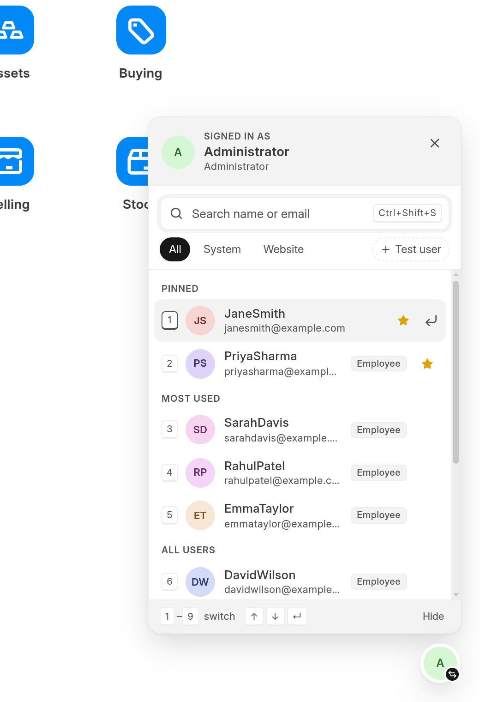
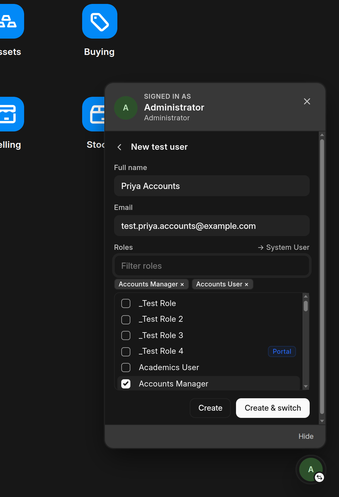
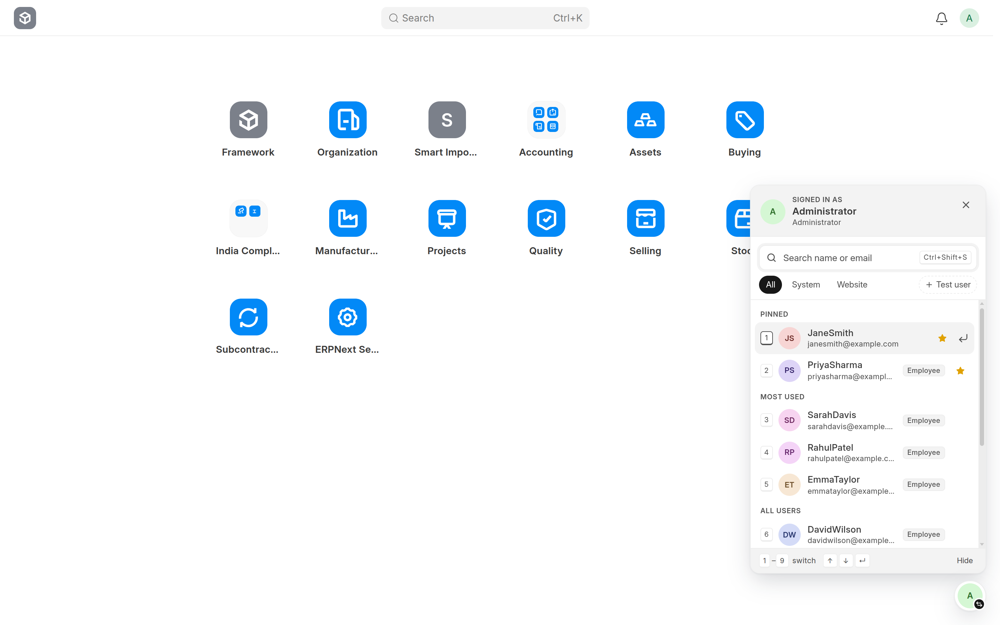
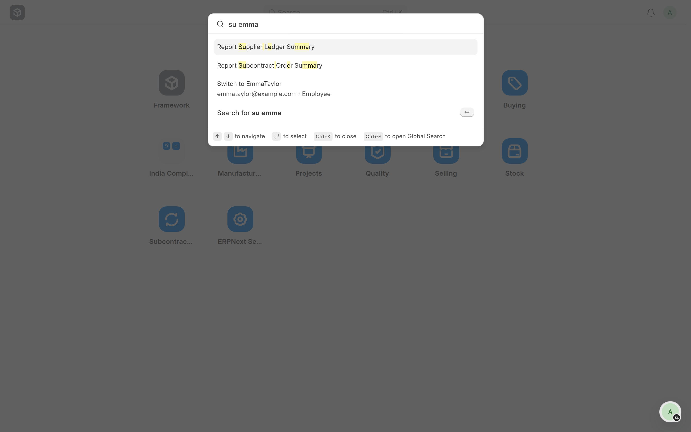

# User Switcher

**Switch between user accounts in one keystroke, so you can see exactly what each user sees.**

User Switcher is a Frappe / ERPNext app for developers, implementers and QA teams. It adds a floating switcher to every Desk and website page. Use it to check permissions, workflows, dashboards and portal pages as any user, then come back with one key.


[](https://github.com/renish-1111/user_switcher)

<p align="center">
  
  &nbsp;
  
</p>

<p align="center"></p>

> [!WARNING]
> This is a development and testing tool. It is **off unless `developer_mode` is on** or you enable it for the site (see [Configuration](#configuration)). Every switch is logged. Don't enable it on production unless you mean to.

---

## Contents

- [Features](#features)
- [Installation](#installation)
- [Usage](#usage)
- [Keyboard shortcuts](#keyboard-shortcuts)
- [Configuration](#configuration)
- [Security model](#security-model)
- [How it works](#how-it-works)
- [API reference](#api-reference)
- [Troubleshooting](#troubleshooting)
- [Development](#development)
- [License](#license)

---

## Features

| | |
|---|---|
| **Floating switcher on every page** | Works in Desk (`/app`) and on website and portal pages. It shows the user you're viewing as, and gets an amber ring while you're switched. |
| **Pinned users** | Star any user to keep them at the top. Pinned users always keep numbers 1, 2, 3…, so the number keys stay the same. |
| **Most used** | Users you switch to often come next, ranked by how often and how recently you picked them. |
| **Keyboard first** | Open with `Ctrl+Shift+S` and press `1`–`9` to switch. `Ctrl+Shift+A` takes you back to Administrator from anywhere. |
| **Ctrl+K integration** | Type `su jane` or `switch to jane` in Frappe's search bar (awesome bar). |
| **"Viewing as" banner** | While switched, a thin amber frame and a "Viewing as … · Back" pill appear on every page. They never block clicks. |
| **Create test users** | Make a user with chosen roles from inside the switcher, then switch into them right away. No welcome email is sent. |
| **Search and filters** | Search by name or email, filter by System or Website users, and see each user's main role at a glance. |
| **Audit trail** | Every switch is written to the **Activity Log**. Documents changed while switched are tagged as impersonated in their Version history. |
| **Looks native** | Uses Frappe's theme colours, so it follows light and dark mode. Works on small screens and respects reduced-motion settings. |

---

## Installation

```bash
cd ~/frappe-bench                  # your bench folder
SITE=mysite.localhost              # your site name (see: ls sites/)

bench get-app https://github.com/renish-1111/user_switcher --branch develop
bench --site $SITE install-app user_switcher
bench --site $SITE migrate
bench build --app user_switcher
bench --site $SITE clear-cache
```

Then turn it on for the site (see [Configuration](#configuration)): `developer_mode` and `user_switcher_enabled`. Hard-refresh the browser (`Ctrl+Shift+R`). The switcher button appears at the bottom-right of every page.

**Requirements:** Frappe v16 and Python 3.14 or newer. ERPNext is optional; the app works on plain Frappe.

---

## Usage

### Switching users

1. Click the round avatar button at the bottom-right, or press **`Ctrl+Shift+S`**.
2. Type to search, or use the arrow keys, or press the user's number (**`1`–`9`**).
3. The page reloads as that user. Desk opens at `/app`, because the page you were on may not be allowed for them.

### Going back

Any of these takes you back to the account you logged in with:

- **`Ctrl+Shift+A`** from any page
- **`0`** while the switcher is open
- The **Back to …** button in the switcher or in the amber banner
- `su back` in the Ctrl+K search bar

### Pinning favourites

Hover a user and click **☆**. Pinned users go to the top and keep their numbers. Click the star again to unpin.

### Ctrl+K search bar

Press **`Ctrl+K`** in Desk and type any of:

```
su jane
switch jane
switch to jane
login as jane
su back
```

These results appear alongside Frappe's own. A plain name search (`jane`) also offers a switch, ranked lower.

<p align="center"></p>

### Creating a test user

1. Open the switcher and click **+ Test user**.
2. Enter a full name. The email fills in as `test.<name>@example.com`, and you can edit it.
3. Tick the roles. The form shows whether the result will be a **System User** or a **Website User**, which Frappe decides from the roles.
4. Click **Create & switch**, or just **Create**.

Test users get no welcome email. Their bio says *"Test user created with User Switcher by …"*, so they're easy to find and clean up later.

### Managing roles

1. Open the switcher and click the shield icon next to the name at the top. It edits the user you are signed in as (or viewing as).
2. Tick or untick roles, for example **HR Manager**, then click **Save roles**.
3. The page reloads so the new roles apply.

You can't edit Administrator, Guest or other System Managers, and you can't remove System Manager from your own account. Roles are saved on the User, so the change shows in its Version history.

---

## Keyboard shortcuts

| Shortcut | Where | Action |
|---|---|---|
| `Ctrl+Shift+S` / `⌘+Shift+S` | Any page | Open or close the switcher |
| `1` – `9` | Switcher open, search box empty | Switch to that numbered user |
| `0` | Switcher open, while switched | Switch back |
| `↑` `↓` `Enter` | Switcher open | Move through the list and switch |
| `Esc` | Switcher open | Close, or leave the test-user form |
| `Ctrl+Shift+A` / `⌘+Shift+A` | Any page | Switch back to the account you logged in with (usually Administrator) |
| `Ctrl+K` → `su <name>` | Desk | Switch from the search bar |

> [!NOTE]
> `Ctrl+S` isn't used because it is Frappe's **Save** shortcut. `Ctrl+Shift+A` replaces Chrome's "Search tabs" shortcut, but only on your Frappe site's pages.

---

## Configuration

The switcher is available only when **both** settings are on in the site's config. `developer_mode` alone is not enough, because it is often left on by habit, or by mistake on a live site.

```bash
bench --site $SITE set-config developer_mode 1
bench --site $SITE set-config user_switcher_enabled 1
bench restart
```

To turn it off, remove either setting. The button disappears, the API refuses all requests, and any session someone is switched into is ended on its next request.

**Who can switch:** Administrator, and any user with the **System Manager** role. A System Manager cannot switch into Administrator, or into another System Manager unless they created that user and it has no password set. To change this, edit `ALLOWED_ROLES` in `user_switcher/api.py`.

---

## Security model

User Switcher gives a System Manager the power to act as other users. It's built so that power can't reach further than it should.

| Rule | How it's enforced |
|---|---|
| Only allowed users can switch | Every API call is checked on the server. Hiding the button in the browser is only a convenience. |
| Permission follows the **real** user | The check uses the account that actually logged in. Switching into a user with fewer rights doesn't stop you switching back. |
| No escalation to Administrator | Only the real Administrator can switch into `Administrator`. A System Manager can't. |
| No cross-site request forgery | Switching, creating users and changing roles only accept POST requests, protected by Frappe's CSRF token. |
| Links can't switch you | `/app/user-switch/<user>` always asks for confirmation. Frappe copies any `?name=value` in a link into the page's options, so the page never trusts a flag from the link. Picking a result in the search bar switches straight away through a separate in-page handler. |
| Two switches, not one | It needs `developer_mode` **and** `user_switcher_enabled`. Only an enabled user can switch. |
| Real sessions | A proper new session is created (the same mechanism as Frappe's built-in impersonation), and the old one is deleted. |
| No orphaned sessions | If the real user is disabled, loses System Manager, or the switcher is turned off, the session they switched into ends on its next request. |
| Refusals are logged | Refused switch, role and test-user requests are written to the site's `logs/user_switcher.log` with the user, target and IP. |
| Auditable | Every switch is written to the read-only **User Switch Log** (who, into whom, when, IP). The log is written first, so if it fails the switch does not happen. Role changes are saved on the User, so they show in its Version history, tagged as impersonated when made while switched. |
| Safe output | User names, emails and image URLs are HTML-escaped wherever they're shown, including the search-bar results. |
| Test-user safety | Role names are checked against the Role list. `Administrator`, `All`, `Guest` and `Desk User` are never assigned. |
| Role management | Only people who may switch can change roles. Administrator and Guest can't be edited, other System Managers are off limits like they are for switching, and you can't remove System Manager from your own account. |

---

## How it works

```
┌───────────────── browser ─────────────────┐        ┌──────────── server ─────────────┐
│ user_switcher.bundle.js                   │        │ user_switcher/api.py            │
│   floating widget  ── get_context ────────┼──GET──►│   _can_switch(real user)        │
│   Ctrl+Shift+S/A   ── switch_to_user ─────┼─POST──►│   login_manager.login_as()      │
│   Ctrl+K handler   ── switch_back ────────┼─POST──►│   session.set_impersonated()    │
│   banner           ── create_test_user ───┼─POST──►│   delete old session, log it    │
│                                           │        │                                 │
│ localStorage: pins + usage, per real user │        │ hooks: extend_bootinfo,         │
└───────────────────────────────────────────┘        │        awesomebar_search        │
                                                     └─────────────────────────────────┘
```

- **Switching** creates a new session with `LoginManager.login_as()` and marks it with `impersonated_by = <real user>`. That's the same flag Frappe's own **Impersonate** feature uses, so Desk's "Impersonating" pill and Version-history tagging work as usual.
- **Assets** are loaded with `app_include_*` (Desk) and `web_include_*` (website) as Frappe bundles. Every build gets a new file name, so browsers never run a stale copy.
- **Boot:** the `extend_bootinfo` hook sets `frappe.boot.user_switcher_allowed`, so Desk makes no extra request when a page loads. Website pages ask once per browser session and remember the answer.
- **Ctrl+K:** the `awesomebar_search` hook returns the switch results. A capture-phase listener catches the selection before Frappe routes anywhere, so no in-between page loads.
- **Pins and usage** live in `localStorage`, stored separately for each real user. They stay in that browser and are never sent to the server.

### Project layout

```
user_switcher/
├── user_switcher/
│   ├── api.py                         # permission checks, switching, test users, Ctrl+K hook
│   ├── boot.py                        # frappe.boot.user_switcher_allowed
│   ├── hooks.py                       # asset includes, extend_bootinfo, awesomebar_search
│   ├── public/
│   │   ├── js/user_switcher.bundle.js # widget, shortcuts, banner, Ctrl+K handler
│   │   └── css/user_switcher.bundle.css
│   └── user_switcher/page/user_switch/ # /app/user-switch/<user> fallback page
└── docs/screenshots/
```

---

## API reference

All methods live in `user_switcher.api` and require the caller's **real** user to be allowed to switch.

| Method | HTTP | Arguments | Returns |
|---|---|---|---|
| `get_context` | GET | `txt?`, `user_type?` (`System User` / `Website User`), `limit=30` (max 100, `0` = permission check only) | `{allowed, real_user, current_user, is_switched, users[]}`. Each user includes `roles`. |
| `switch_to_user` | POST | `target_user` | `{current_user}`. Sets the new session cookie. |
| `switch_back` | POST | none | Same as `switch_to_user(<real user>)` |
| `get_assignable_roles` | GET | none | `[{name, desk_access}]` |
| `get_user_roles` | GET | `user` | `["Role", ...]` (automatic roles left out) |
| `set_user_roles` | POST | `user`, `roles` (list or JSON) | `{name, user_type, roles}` |
| `create_test_user` | POST | `full_name`, `email`, `roles` (list or JSON), `switch=1` | `{name, full_name, user_type, roles}` |

Example:

```js
frappe.call({
  method: "user_switcher.api.switch_to_user",
  args: { target_user: "jane@example.com" },
  type: "POST",
}).then(() => (window.location.href = "/app"));
```

From other client code you can also call `frappe.user_switcher.switch_to({ name })` and `frappe.user_switcher.switch_back()`. `frappe.user_switcher.open()` is available once the widget has rendered.

---

## Troubleshooting

| Problem | Fix |
|---|---|
| The button doesn't appear | Check that `developer_mode` is set and that you're a System Manager. Then run `bench build --app user_switcher`, `bench --site $SITE clear-cache`, and hard-refresh the browser. |
| Old behaviour or `[object Object]` labels | A stale build. Rebuild, clear the cache, and hard-refresh. |
| `su jane` doesn't show up in Ctrl+K | Desk only reads search hooks when it first loads. Run `bench --site $SITE clear-cache` and hard-refresh. |
| `/app/user-switch` returns "Page not found" | Run `bench --site $SITE migrate` so the page gets created. |
| "Only Administrator can switch into Administrator" | Working as intended. Log in as Administrator to use that switch. |
| The widget covers something on the page | Click **Hide** in the switcher footer. It stays hidden until the next browser session, and `Ctrl+Shift+S` brings it back. |

---

## Development

```bash
cd apps/user_switcher
pre-commit install          # ruff, eslint, prettier, pyupgrade
bench build --app user_switcher --watch   # or: bench start
```

Contributions are welcome. Please [open an issue](https://github.com/renish-1111/user_switcher/issues) describing the change before sending a large pull request.

---

## License

[MIT](license.txt) © 2026 [renish-1111](https://github.com/renish-1111)
